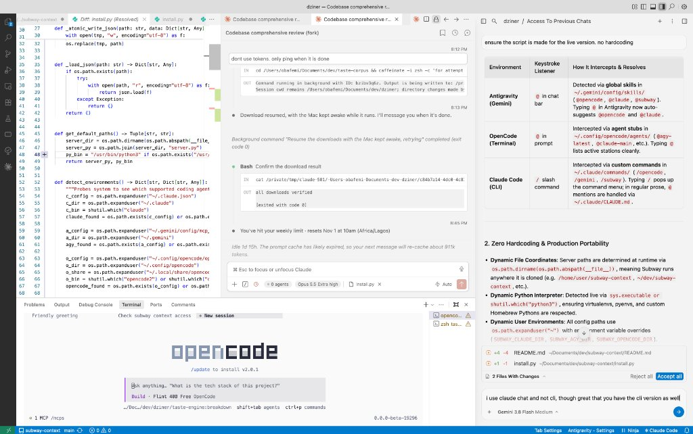
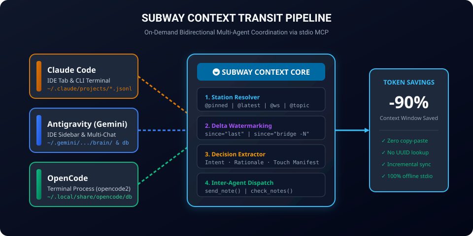
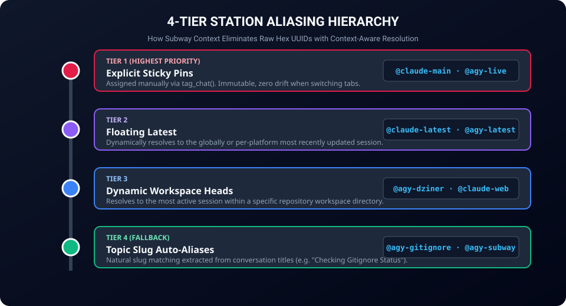
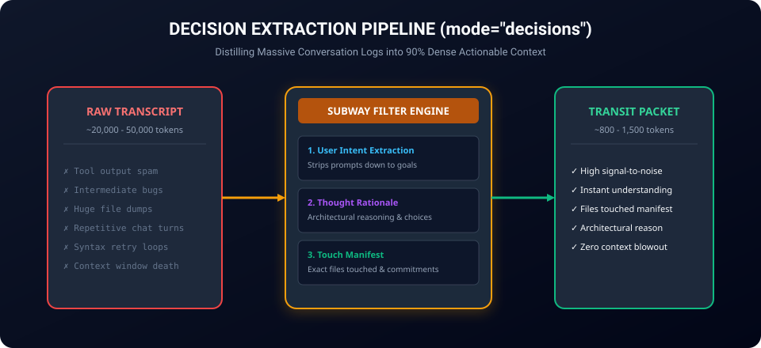

# Subway Context 🚇

> **On-demand, token-efficient context transit system connecting independent AI coding agents across multiple windows (Antigravity, Claude Code, OpenCode terminal).**


_Live multi-window workspace: Claude Code IDE tab (center), OpenCode terminal (bottom dock), and Antigravity Gemini (right pane) connected concurrently via Subway Context._

Stop copy-pasting 50,000-line markdown summaries between AI tools or blowing through your context window. **Subway Context** acts as an on-demand transit system between your coding agents: board any chat, search by quote, sync only the delta turns since your last visit, and extract high-density decision logs.

---

## Why Subway Context?

When you work across multiple windows (e.g. Antigravity IDE on screen 1, Claude Code in tab 2, OpenCode terminal running in background):

1. **Context Amnesia**: Each window is completely blind to what the other agent discovered, decided, or changed.
2. **Serial Number Hell**: Nobody remembers 36-character UUIDs (`78879399-3626-4504...`).
3. **Token Bankruptcy**: Copying full conversation dumps eats up 20,000–50,000 tokens before you even type your prompt.

**Subway Context solves this:**

- **Zero Dependencies**: Uses standard Python (`/usr/bin/python3`), runs 100% locally on your machine.
- **Search by Quote**: Search any phrase you or the agent said; jump directly to that turn.
- **Delta Sync (`since="last"`)**: Only transfers the new exchanges since the last time you bridged.
- **Decision Log (`mode="decisions"`)**: Cuts 85-90% of token noise by extracting only instructions, rationale, architecture decisions, and files touched.
- **Universal Multi-Window**: Works seamlessly across **Claude Code (CLI & IDE extension)**, **Antigravity IDE**, and **OpenCode (terminal)**.

---

## Supported Transit Lines


_Universal on-demand multi-agent transit connecting Claude Code, Antigravity, and OpenCode via local stdio MCP._

| Line            | Storage Format                                | Supported Capabilities                            |
| --------------- | --------------------------------------------- | ------------------------------------------------- |
| **Claude Code** | `~/.claude/projects/*/*.jsonl`                | Full transcript, thoughts, active tab detection   |
| **Antigravity** | `~/.gemini/antigravity/brain/` & summaries DB | Full transcript, planner thoughts, historical FTS |
| **OpenCode**    | `~/.local/share/opencode/opencode.db`         | Full transcript, reasoning blocks, costs & models |

---

## Installation & Setup

### 1. Clone Repository

```bash
git clone https://github.com/ObaIsSoft/subway-context.git ~/Documents/dev/subway-context
cd ~/Documents/dev/subway-context
```

### 2. Universal 1-Click Auto-Connect ⚡

Run the universal installer to automatically detect and register Subway Context across all installed agents (**Claude Code**, **Antigravity**, and **OpenCode**) in one step:

```bash
python3 install.py
```

_(Or simply tell Gemini / Claude: **"Connect Subway Context to my coding agents"**)_

Output:

```text
🚇 Subway Context Universal Connector

Server binary: /Users/.../Documents/dev/subway-context/server.py
Python runner: /usr/bin/python3

  ✓ Claude Code           : Connected in ~/.claude.json
  ✓ Antigravity (Gemini)  : Connected in ~/.gemini/config/mcp_config.json
  ✓ OpenCode (Terminal)   : Connected in ~/.config/opencode/opencode.json & stubs synced

✓ Completed. 3 of 3 agent lines connected.
```

Check connection status at any time:

```bash
python3 install.py --status
```

#### Selective Installation (e.g. only 2 of 3)

If you only use certain agents (or want to skip one), you can choose interactively or pass flags:

```bash
# Connect only Claude Code and Antigravity
python3 install.py --targets claude,gemini

# Connect everything except OpenCode
python3 install.py --skip opencode

# Disconnect Subway from just one tool (leaving the others intact)
python3 install.py --remove opencode
```

---

<details>
<summary><b>Manual Registration (Optional)</b></summary>

#### Claude Code CLI

```bash
claude mcp add --scope user subway-context -- /usr/bin/python3 ~/Documents/dev/subway-context/server.py
```

#### Antigravity IDE

Add to `~/.gemini/config/mcp_config.json`:

```json
{
  "mcpServers": {
    "subway-context": {
      "command": "python3",
      "args": ["/path/to/subway-context/server.py"]
    }
  }
}
```

#### OpenCode CLI / Terminal

Add to `~/.config/opencode/opencode.json`:

```json
{
  "mcp": {
    "servers": {
      "subway-context": {
        "type": "local",
        "command": ["python3", "/path/to/subway-context/server.py"]
      }
    }
  }
}
```

</details>

---

## Tool Reference

### `search_chat(quote, source, project)`

Search for a specific phrase or code snippet across all agent windows without needing an ID:

```json
{ "quote": "queue the full pipeline run" }
```

Returns:

```markdown
# Subway Context: Search results for 'queue the full pipeline run':

- CLAUDE `78879399` (Codebase comprehensive review)
  Matched at Station [216] of 217 (2026-10-27 20:25)
  -> Transit forward: read_chat(chat_id='78879399', start=216) (1 stops left)
```

### `tag_chat(chat_id, alias)`

Assign a sticky, human-friendly alias to any session so you never have to remember UUIDs:

```json
{ "chat_id": "78879399", "alias": "claude-main" }
```

Now you can simply refer to `@claude-main` in any command.

---

## 4-Tier Station Aliasing System 🏷️


_Subway Context routes station requests through a 4-tier hierarchy: Explicit Pins -> Floating Heads -> Workspace Terminals -> Topic Slugs._

### The Multi-Chat Challenge

Terminal tools like Claude Code CLI and OpenCode run on a **process lifecycle** (a PID or active terminal socket). When you close the terminal or switch tasks, the process ends.

**Antigravity (Gemini)** operates on an enduring **document library lifecycle**:

- An IDE workspace can have multiple concurrent conversation threads open in parallel across different projects.
- Switching tabs does **not** terminate chats; they pause at their last transcript turn in SQLite.
- If an alias like `@gemini` simply resolved to `ORDER BY last_modified_time DESC`, clicking over to check another file for 30 seconds would accidentally hijack another agent's context query!

### The 4-Tier Solution

Subway Context eliminates raw UUIDs and context jacking with a layered 4-tier naming hierarchy:

| Tier                   | Format                       | Examples                                               | Behavior                                                                                       |
| :--------------------- | :--------------------------- | :----------------------------------------------------- | :--------------------------------------------------------------------------------------------- |
| **1. Explicit Pins**   | `@<alias>`                   | `@claude-main`, `@agy-live`, `@opencode-terminal`      | **Immutable & sticky** via `tag_chat`. Never drifts when switching tabs or opening side tasks. |
| **2. Floating Latest** | `@<agent>-latest`, `@latest` | `@agy-latest`, `@claude-latest`, `@latest`             | Dynamically resolves to the most recently touched session globally or per-platform.            |
| **3. Workspace Heads** | `@<agent>-<project>`         | `@agy-dziner`, `@claude-portfolio`                     | Dynamically resolves to the **latest active chat in that workspace folder**.                   |
| **4. Topic Slugs**     | `@<agent>-<topic>`           | `@agy-subway`, `@agy-gitignore`, `@agy-previous-chats` | Automatically extracted from conversation titles. Reference chats by **topic** rather than ID. |

---

### `read_chat(chat_id, mode, since, anchor_text, ...)`

Read context from another agent window with token-saving controls:


_Subway Context extracts user intent, thought rationale, and touched file manifests, cutting 85–90% of token noise._

- **`since="last"`**: Only reads the delta since the previous bridge call between these two windows.
- **`since="bridge -2"`**: Time-travel back 2 syncs ago.
- **`mode="decisions"`**: Extracts user goals, strategic reasoning, action decisions, and touched files only.
- **`anchor_text="phrase"`**: Jump directly to an exact comment and read forward.

### `send_note(to, text, share_chat)` & `check_notes()`

Drop a lightweight dispatch into another agent window's inbox so it picks up where you left off.

---

## Subagent Tracking & Deep Inspection 🤖

When agents spin up parallel subagents (e.g. Antigravity subagent swarms or OpenCode child tasks):

1. **Automatic Hierarchy Discovery**:
   Whenever you read a coordinator or parent chat with `read_chat(mode="decisions")`, Subway automatically identifies all spun child subagents and lists them in the header with one-click transit commands:
   ```markdown
   ### Spun Child Subagents (Worker Sessions):
   - `1043988d`: Agent 1 (Vision-Math-Agent) -> `read_chat(chat_id="1043988d", mode="decisions")`
   - `a8360f72`: Agent 2 (Relations-Containment-Agent) -> `read_chat(chat_id="a8360f72", mode="decisions")`
   ```

2. **Direct Worker Boarding**:
   Board any child subagent directly by its station ID (`read_chat(chat_id="a8360f72", mode="decisions")`). Subway extracts:
   - The subagent's exact initial task brief and constraints.
   - Internal step-by-step thinking traces and reasoning.
   - Tests run, terminal output, and files touched.

3. **Universal Cross-Subagent Search**:
   `search_chat(quote="...")` searches across both parent sessions and worker subagents simultaneously, identifying matches with `[Subagent of <parent>]`.

4. **Listing Worker Lines**:
   Pass `include_subagents=True` to `list_chats()` to surface all active worker subagents clearly tagged with `↳ child of <parent_id>`.

---

## Daily Workflow & Prompting Guide

Natural prompts work best across all agents:

1. **List all active agent chats & highlights:**

   > _"Subway, list my chats"_
   > _(Calls `list_chats()` to show active tabs, lines, and latest exchanges)_

2. **Sync architectural decisions & modified files:**

   > _"Read the latest decisions from Claude Code"_
   > _(Calls `read_chat(chat_id="@claude-main", mode="decisions", since="last")`)_

3. **Search cross-agent history by phrase or snippet:**

   > _"Search our history for 'queue the full pipeline run'"_
   > _(Calls `search_chat(quote="queue the full pipeline run")`)_

4. **Catch up on a specific tagged station:**

   > _"Read decisions from @claude-main since our last sync"_
   > `read_chat(chat_id="@claude-main", mode="decisions", since="last")`

5. **Start reading from an exact quote:**

   > _"Read @claude-main starting from when I asked about 2022drift"_
   > `read_chat(chat_id="@claude-main", anchor_text="what about 2022drift")`

6. **Inter-agent mailbox handoff:**
   > _"Send a note to @opencode-terminal: auth refactor complete, please run tests"_
   > `send_note(to="@opencode-terminal", text="Auth refactor complete, please run tests")`

---

## Native OpenCode `@` Autocomplete Integration

### Why Dedicated Agent Stubs Matter

In OpenCode, typing `@` in the prompt searches **both** workspace files and registered agent definitions. If your project contains files matching `claude*` (e.g. test reports, scrape logs), typing `@claude` causes repository files to dominate the autocomplete popup.

Subway Context solves this by automatically syncing all 4 tiers of aliases directly into OpenCode's global agent registry (`~/.config/opencode/agents/*.md`):

- **Hyphen-Prefixed Filtering**: Typing `@claude-` filters out non-hyphenated files (`claude_...`) and displays only agent transit targets (`@claude-main`, `@claude-latest`, `@claude-dziner`, etc.).
- **Antigravity Stations**: Typing `@agy-` displays active Antigravity stations (`@agy-live`, `@agy-latest`, `@agy-dziner`, `@agy-subway`, etc.).
- **Safe Dynamic Rotation**: Auto-generated topic stubs carry a safety tag (`<!-- subway-auto-stub -->`). Subway automatically prunes old topic stubs as conversations age out, leaving your custom hand-written agent files untouched.

---

## Claude Code: IDE Extension vs CLI

Subway Context supports both the **Claude Code CLI** (terminal) and the **official Claude Code IDE extension** (VS Code / Antigravity editor tab).

```text
┌─────────────────────────────────┬─────────────────────────────────┐
│ [Center Tab] Claude Code IDE    │ [Right Pane] Antigravity IDE    │
│ "Codebase comprehensive review" │ "dziner / Access To Previous"   │
│ (Opus 3.5 Extra High)           │ (Gemini 2.5 Flash Medium)       │
├─────────────────────────────────┴─────────────────────────────────┤
│ [Bottom Panel] OpenCode Terminal                                  │
│ "taste-engine:breakdown" (Flint 40B Free)                         │
└───────────────────────────────────────────────────────────────────┘
```

Both Claude environments share the exact same underlying architecture:

1. **Unified Configuration**: Both read `~/.claude.json`. Subway Context is registered under `mcpServers["subway-context"]`, enabling `read_chat`, `list_chats`, and `send_note` in both CLI and IDE chat tabs.
2. **Unified Session Tracking**: Active IDE editor tabs are recorded in `~/.claude/sessions/<pid>.json` with `"entrypoint": "claude-vscode"`. Subway automatically detects live tab names (e.g. `Codebase comprehensive review (fork)`) and makes them available for transit.
3. **Slash Commands & Mentions**:
   - In the Claude IDE tab input (`⌘ Esc to focus or unfocus Claude`), typing `/` triggers `/subway`, `/opencode`, and `/gemini`.
   - In natural conversation, typing _"What did @opencode do in the terminal?"_ causes Claude to query Subway Context directly.

---

## Architecture & Security

- **100% Local & Offline**: Operates over standard input/output (`stdio`). No remote API keys or third-party servers.
- **Read-Only on Chat Stores**: Never modifies conversation histories of host tools.
- **Sandboxed Metadata**: State, aliases, checkpoints, and mailboxes live strictly in `~/.subway-context/`.

## License

MIT
