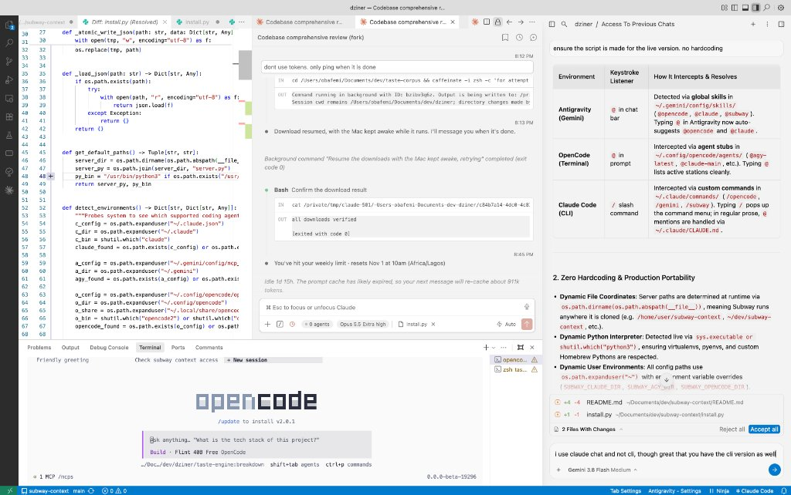
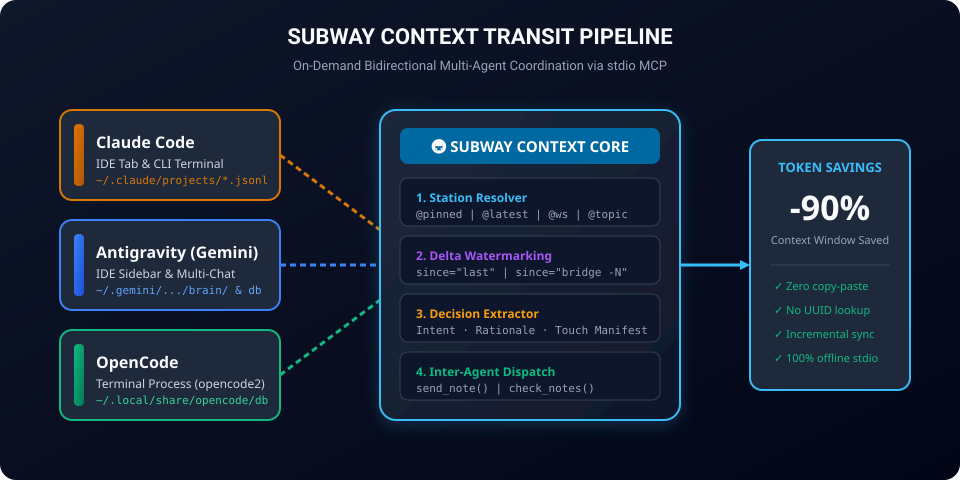
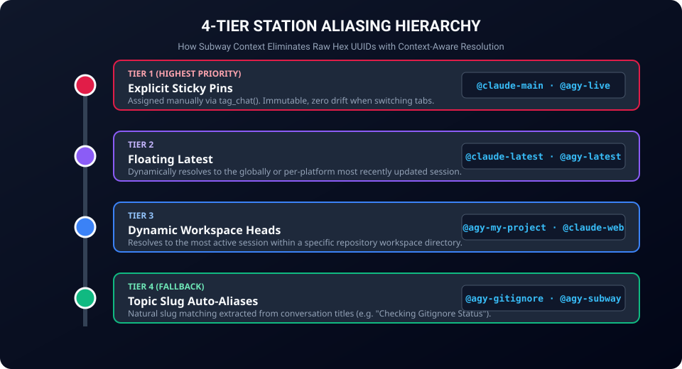

# Subway Context

> **On-demand, token-efficient context transit system connecting independent AI coding agents across multiple windows (Antigravity, Claude Code, OpenCode terminal).**


_Live multi-window workspace: Claude Code IDE tab (center), OpenCode terminal (bottom dock), and Antigravity Gemini (right pane) connected concurrently via Subway Context._

Stop copy-pasting 50,000-line markdown summaries between AI tools or blowing through your context window. **Subway Context** acts as an on-demand transit system between your coding agents: board any chat, search by quote, sync only the delta turns since your last visit, and extract high-density decision logs.

---

## Why Subway Context?

When you work across multiple windows (e.g. Antigravity IDE on screen 1, Claude Code in tab 2, OpenCode terminal running in background):

1. **Context Amnesia**: Each window is completely blind to what the other agent discovered, decided, or changed.
2. **Serial Number Hell**: Nobody remembers 36-character UUIDs (`78879399-3626-4504...`).
3. **Token Bankruptcy**: Copying full conversation dumps eats up 20,000–50,000 tokens before you even type your prompt.

**Subway Context solves this:**

- **Zero Dependencies**: Uses standard Python (`/usr/bin/python3`), runs on your own machine.
- **Search by Quote**: Search any phrase you or the agent said; jump directly to that turn.
- **Delta Sync (`since="last"`)**: Only transfers the new exchanges since the last time you bridged.
- **Decision Log (`mode="decisions"`)**: Cuts 85-90% of token noise by extracting only instructions, rationale, architecture decisions, and files touched.
- **Universal Multi-Window**: Works seamlessly across **Claude Code (CLI & IDE extension)**, **Antigravity IDE**, and **OpenCode (terminal)**.
- **Workspace Guard & HUD**: Coordinates file leases, multi-agent worker swarms, permission approval relays, and quota monitoring.

---

## Supported Transit Lines


_Universal on-demand multi-agent transit connecting Claude Code, Antigravity, and OpenCode via local stdio MCP._

| Line | Storage Format | Supported Capabilities |
| --- | --- | --- |
| **Claude Code** | `~/.claude/projects/*/*.jsonl` | Full transcript, thoughts, active tab detection, PreToolUse collision hook, permission relay |
| **Antigravity** | `~/.gemini/antigravity/brain/` & summaries DB | Full transcript, planner thoughts, historical FTS, worker dispatch via `agy` CLI |
| **OpenCode** | `~/.local/share/opencode/opencode.db` | Full transcript, reasoning blocks, costs & models, subagent stubs |
| **Kimi** | Applications / VS Code extension | *Detection only* (Subway discovers installation; does not dispatch or read usage) |
| **GitHub Copilot** | VS Code extensions / data | *Detection only* (Subway discovers installation; does not dispatch or read usage) |

---

## Installation & Setup

### 1. Clone Repository

```bash
git clone https://github.com/ObaIsSoft/subway-context.git ~/Documents/dev/subway-context
cd ~/Documents/dev/subway-context
```

### 2. Universal 1-Click Auto-Connect

Install subway-context directly via npm (v1.2.0):

```bash
npx -y subway-context install
```

Or run the universal installer script locally:

```bash
python3 install.py
```

_(Or simply tell Gemini / Claude: **"Connect Subway Context to my coding agents"**)_

Output:

```text
Subway Context Universal Connector

Server binary: /Users/.../Documents/dev/subway-context/server.py
Python runner: /usr/bin/python3

  [+] Claude Code           : Connected in ~/.claude.json
  [+] Antigravity (Gemini)  : Connected in ~/.gemini/config/mcp_config.json
  [+] OpenCode (Terminal)   : Connected in ~/.config/opencode/opencode.json & stubs synced

[OK] Completed. 3 of 3 agent lines connected.
```

Check connection status at any time:

```bash
python3 install.py --status
```

#### Selective Installation (e.g. only 2 of 3)

If you only use certain agents (or want to skip one), you can choose interactively or pass flags:

```bash
# Connect only Claude Code and Antigravity
python3 install.py --targets claude,gemini

# Connect everything except OpenCode
python3 install.py --skip opencode

# Disconnect Subway from just one tool (leaving the others intact)
python3 install.py --remove opencode
```

---

<details>
<summary><b>Manual Registration (Optional)</b></summary>

#### Claude Code CLI

```bash
claude mcp add --scope user subway-context -- /usr/bin/python3 ~/Documents/dev/subway-context/server.py
```

#### Antigravity IDE

Add to `~/.gemini/config/mcp_config.json`:

```json
{
  "mcpServers": {
    "subway-context": {
      "command": "python3",
      "args": ["/path/to/subway-context/server.py"]
    }
  }
}
```

#### OpenCode CLI / Terminal

Add to `~/.config/opencode/opencode.json`:

```json
{
  "mcp": {
    "servers": {
      "subway-context": {
        "type": "local",
        "command": ["python3", "/path/to/subway-context/server.py"]
      }
    }
  }
}
```

</details>

---

## 4-Tier Station Aliasing System


_Subway Context routes station requests through a 4-tier hierarchy: Explicit Pins -> Floating Heads -> Workspace Terminals -> Topic Slugs._

### The Multi-Chat Challenge

Terminal tools like Claude Code CLI and OpenCode run on a **process lifecycle** (a PID or active terminal socket). When you close the terminal or switch tasks, the process ends.

**Antigravity (Gemini)** operates on an enduring **document library lifecycle**:

- An IDE workspace can have multiple concurrent conversation threads open in parallel across different projects.
- Switching tabs does **not** terminate chats; they pause at their last transcript turn in SQLite.
- If an alias like `@gemini` simply resolved to `ORDER BY last_modified_time DESC`, clicking over to check another file for 30 seconds would accidentally hijack another agent's context query!

### The 4-Tier Solution

Subway Context eliminates raw UUIDs and context jacking with a layered 4-tier naming hierarchy:

| Tier | Format | Examples | Behavior |
| :--- | :--- | :--- | :--- |
| **1. Explicit Pins** | `@<alias>` | `@claude-main`, `@agy-live`, `@opencode-terminal` | **Immutable & sticky** via `tag_chat`. Never drifts when switching tabs or opening side tasks. |
| **2. Floating Latest** | `@<agent>-latest`, `@latest` | `@agy-latest`, `@claude-latest`, `@latest` | Dynamically resolves to the most recently touched session globally or per-platform. |
| **3. Workspace Heads** | `@<agent>-<project>` | `@agy-my-project`, `@claude-portfolio` | Dynamically resolves to the **latest active chat in that workspace folder**. |
| **4. Topic Slugs** | `@<agent>-<topic>` | `@agy-subway`, `@agy-gitignore`, `@agy-previous-chats` | Automatically extracted from conversation titles. Reference chats by **topic** rather than ID. |

---

## Core Tool Reference

Subway Context exposes 29 MCP tools divided across functional roles:

### 1. Navigation & Transit
- **`list_chats(source, project, query, limit, include_subagents)`**: List active stations across agents, highlighting open tabs and sticky `@aliases`.
- **`search_chat(quote, query, source, project, limit, include_subagents)`**: Search all transcripts for an exact phrase or snippet; returns station ID and stop index.
- **`tag_chat(alias, chat_id)`**: Assign a sticky station alias (`tag_chat(alias='claude-main')`). Omit `chat_id` to tag current chat.
- **`read_chat(chat_id, mode, turns, start, since, anchor_text, max_chars, include_tools, include_thoughts, source, project)`**: Board and read another agent's transcript.
  - `since="last"`: Reads only new turns since previous transit.
  - `mode="decisions"`: Cuts 85-90% token noise by extracting user intent, thought rationale, decisions, and files touched.
  - `anchor_text="phrase"`: Boards at the exact quote.
- **`send_note(to, text, from_chat, share_chat)`**: Send transit dispatch to another agent window's inbox.
- **`check_notes(my_chat_id, keep)`**: Read and clear incoming dispatches for this window.
- **`whoami()`**: Reports current station ID, provider, and active tab identity.

### 2. Live Workspace Guard
- **`claim_file(filepath, holder, duration_seconds, purpose, baseline_commit, role, project_dir)`**: Acquire a temporary lease on a file.
- **`signoff_file(filepath, verdict, notes, reviewer, project_dir)`**: Formally review and sign off on completed edits to prevent regression. The agent that modified the file cannot sign off on its own work.
- **`release_file(filepath, holder, project_dir, force)`**: Relinquish a file lease.
- **`list_locks()`**: Surface active file leases, expiry countdowns, and sign-offs across all agents.

### 3. Worker Delegation & Supervision
- **`spin_worker(role, prompt, provider, model, track, project_dir, timeout_seconds, effort, mode, permission_mode, capabilities, budget_session_pct, budget_weekly_pct, max_budget_usd, thread)`**: Queue an autonomous background worker. **Workers always require user approval before starting.**
- **`approve_worker(worker_id, approval_code)`**: Launch a pending worker using the user-provided approval code.
- **`reject_worker(worker_id, reason)`**: Reject a pending worker or cancel a running worker.
- **`stop_worker(worker_id, reason)`**: Terminate a running worker's process.
- **`worker_status(worker_id, track)`**: Inspect status, exit code, and log tail of workers.
- **`collect_reports(track, wait)`**: Collect completion summaries and log tails from workers on a track.
- **`estimate_complexity(prompt, role)`**: Advisory evaluation recommending model tier, effort, and provider.
- **`escalate_worker(worker_id, new_effort, new_mode, reason, successor_provider)`**: Replace a struggling worker with a higher-tier successor (queued for user approval).

### 4. Permissions & Oversight
- **`permission_requests(worker_id)`**: List worker permission requests waiting on user decision.
- **`answer_permission(request_id, decision)`**: Submit user decision (`allow`, `allow_always`, or `deny`). Agents must ask the user first.
- **`watch_workers(wait_seconds)`**: Wait up to `wait_seconds` for a worker to finish or request a permission.

### 5. Quota & Limits
- **`quota_status(source)`**: Inspect session and weekly limits, token counts, and freshness.
- **`set_quota(category, weekly_left_pct, session_5h_left_pct)`**: Record manual quota limits when live readings are unavailable.

### 6. Shared Tracks & Dashboard
- **`join_track(track, station_id)`**: Subscribe to a shared decision track.
- **`broadcast_track(message, track, files, decisions, station_id, session_id)`**: Append an event or decision to the shared ledger.
- **`read_track(track, limit, since_timestamp)`**: Read synchronized cross-agent decisions.
- **`hud_status(project)`**: Departure-board status snapshot across lines, locks, workers, and tracks.
- **`start_hud(port)`**: Start the Live HUD server on loopback (`127.0.0.1`).

---

## Live Workspace Guard (Collision Shield)

When multiple autonomous agents (e.g. Claude Code in tab 1, OpenCode in terminal dock, and Antigravity in sidecar) run concurrently in the same repository, they risk **file collision**—clobbering and overwriting each other's edits.

Subway Context provides a central **Workspace Guard** (`~/.subway-context/locks.json`):

1. **`claim_file(filepath, ...)`**: Acquires a time-limited lease (default: 300s).
   ```text
   [COLLISION WARNING] 'src/components/Header.tsx' is already leased to claude-main for 'Layout refactor'. 
   Lease expires in 240s. Do NOT overwrite or clobber until released or expired.
   ```
2. **Lease Enforcement**:
   - File leases are **advisory** across agents to avoid breaking workflows.
   - **Exception**: In **Claude Code**, edits are strictly **enforced** by the `PreToolUse` hook (`server.py hook-guard` registered in `~/.claude/settings.json`). If Claude attempts to edit a file currently leased to another agent, the hook intercepts and denies the tool call. The hook is designed to fail open if Subway is ever unreachable.
3. **`signoff_file(filepath, ...)`**: Formally reviews completed changes and anchors them against git commits to prevent regressions. Approval must come from an agent different from the implementer.
4. **`release_file(filepath)`**: Explicitly relinquishes the file lease once modifications and git commits are done.

---

## Live Station Board HUD

Subway Context includes a real-time, interactive **Station Departure Board HUD** available both in the terminal and as a cyber-transit dark-mode web dashboard.

### Architecture & Security

- **Native ES Modules**: The HUD lives in the `hud/` folder as native ES modules with **zero build step** (`hud/index.html`, `app.js`, `views.js`, `usage.js`, `lib.js`, `styles.css`).
- **Loopback Only (`127.0.0.1`)**: The HUD server binds strictly to `127.0.0.1` (or `SUBWAY_HUD_PORT`, default 7890). There is deliberately no option to bind to `0.0.0.0` or external network interfaces.
- **Per-User Authentication Token**: Protected by a random HMAC token stored in `~/.subway-context/hud_token`. The token is injected into served HTML and validated via the `X-Subway-Token` header on all API calls. Requests missing or mismatched tokens are rejected with `403 Forbidden`.
- **Live Updates**: HUD updates are pushed the moment a worker or permission changes (`GET /api/events`), about 1 ms locally. Chats still depend on the model taking its turn.
- **HUD Features**: Displays budget rows with real usage, a reset card that cycles through providers, a spend chart coloured per provider, and worker history pages with Load more.
- **No Automatic Launch**: To conserve resources, the HUD **no longer starts automatically** when MCP connects. You start it whenever you want via:
  1. The `start_hud` MCP tool
  2. CLI: `subway-context hud` (or `python3 server.py hud [--open] [port]`)
  3. Setting `SUBWAY_HUD_AUTOSTART=1` in your environment

### Opening the HUD in an IDE Browser

You can open the HUD in your system browser or inside an IDE built-in browser panel (such as VS Code's Simple Browser or Antigravity's webview):

```text
http://127.0.0.1:7890
```

#### Custom Allowed Origins (`SUBWAY_HUD_ORIGINS`)

By default, the HUD server permits requests originating from `http://127.0.0.1:<port>` and `http://localhost:<port>`. If your IDE browser or webview uses a specific custom origin header, configure it by setting `SUBWAY_HUD_ORIGINS`:

```bash
export SUBWAY_HUD_ORIGINS="vscode-webview://*,http://127.0.0.1:3000"
```

---

## Quota & Rate Limit Tracking

Subway Context tracks live rate limits, token usage, and session windows across detected AI clients:

- **Data Sources**:
  - **Antigravity**: Read live from the local Antigravity language server metrics.
  - **Claude Code**: Read from Claude Code `/usage` and token tracking.
  - **OpenCode**: Read from the local OpenCode SQLite database (`~/.local/share/opencode/opencode.db`).
- **Unknown & Stale Indicators**: If an agent hasn't reported data or its server is temporarily unreachable, Subway retains the last-known reading and explicitly reports unknown values rather than guessing.
- **OpenCode Limits**: OpenCode uses a background service, so no terminal needs to stay open. It publishes no remaining free allowance, so limits show only when a limit error occurs; Subway displays its active model and token counts without synthetic limit caps.
- **Kimi & GitHub Copilot**: Reported as **detection only** (`state="detected"`). Subway detects installed binaries and IDE extensions, but neither client exposes a local usage API, nor does Subway dispatch background workers to them.
- **Manual Overrides (`set_quota`)**: Users can record manual limits if an agent cannot report them automatically. Live readings always supersede manual overrides.

### Budgets & Capacity

- **Budgets**: `subway-context budget` shows them; `subway-context budget <chat|provider> <tokens>` sets them; typing that command as your own chat message in Claude Code works, including 3.5M and even when blocked. The HUD sets them too. Agents can't: the guard is best effort for shell commands.
- **Enforcement**: Warnings at 80%, block at 100%. Claude Code blocks the prompt and tools through hooks. Antigravity and OpenCode have no such hook, so there the block lands on the next Subway tool call.
- **Worker Token Caps**: Workers are told to wrap up at two thirds, and no call is started that would pass the cap. A call already running can still overrun. Counts thinking and Claude cache creation. Set Claude caps above about 100K: one call can cost 35K. Custom providers report no tokens, so they use max_seconds.
- **Capacity**: 4 running workers per chat. Per machine: 2 up to 8 GB, 6 up to 16 GB, 10 above, or set `max_workers` in `config.json`. A worker over the limit stays queued.

---

## Autonomous Worker Swarms & Approval Workflow

Subway Context allows agents to queue background tasks across different engines (`claude`, `opencode`, or `antigravity`).

### Mandatory User Approval

Workers **always require user approval** before any execution begins:
1. When an agent calls `spin_worker(...)`, the worker is placed in `pending_approval` state.
2. The user can approve the worker in three ways:
   - **In the Live HUD**: Clicking "Approve" (authenticated via HUD token).
   - **Via CLI**: Running `subway-context approve <worker_id>` in their terminal.
   - **Via Approval Code**: Giving the 6-character approval code shown in the HUD or CLI to their agent to call `approve_worker(worker_id="...", approval_code="...")`.
3. **No Agent Self-Approval**: Agents **cannot self-approve** workers through MCP—they do not have access to the approval code unless the user explicitly pastes it. However, any process with shell access running as your user can still execute the CLI command `subway-context approve <id>`.

### Provider Dispatch & Antigravity CLI Note

- **Claude Workers**: Run via the `claude` CLI with `--effort`, `--model`, and custom tool permissions.
- **OpenCode and Local Workers**: Run through ACP, so they ask permission and can be denied. auto_safe lets them read and edit inside their own folder.
- **Custom Providers**: Add a CLI to `providers.json` with `id`, `name`, `bin`, `args` using `{prompt}`, `model_args` using `{model}`, and `skills`. Custom providers report no tokens, so they use max_seconds.
- **Antigravity Workers**: Run through the **`agy` CLI binary** (`agy --print ...`). Note that `agy` runs detached batch CLI sessions and **cannot continue an active Antigravity IDE conversation**.
- **God Mode (`mode="god"`)**: No worker count, only free memory limits it. auto spreads work across providers with Claude only as a last resort. It may still pick a model with no quota left.
- **Sign-in Failures**: Models that fail sign-in are skipped for 24 hours.

### Permission Modes

Workers use permission modes to govern actions:
- **ask (Default)**: Always ask before running actions.
- **auto_safe**: Automatically approves safe read-only and diagnostic commands; lets OpenCode and local workers read and edit inside their own folder.
- **auto_approve**: Auto-approves actions only if the user explicitly chooses it. Agents cannot enable this mode on their own.

### Platform Support

- macOS and Linux are supported. Worktrees are removed after each worker.
- Windows is written but untested.

### Worker Pings & Priority

- **Worker Pings**: Finished, failed or stopped workers report to the launching chat. Every client gets a line on its next tool result; Claude Code also gets it on your next message.
- **Worker Priority**: Urgent, normal, low. Waits return as soon as an urgent worker needs attention.

### Permission Relay & Commands

When a worker needs permission:
- **Relay Reach**: Requests reach the launching chat automatically **on its next Subway tool call** (appended to the tool output), or through the `watch_workers` tool.
- **Terminal Oversight Commands**:
  - `subway-context permissions`: List all pending permission requests.
  - `subway-context allow <request_id>`: Allow the action once.
  - `subway-context always <request_id>`: Allow this and future identical requests.
  - `subway-context deny <request_id>`: Deny the requested action.
  - `subway-context watch [seconds]`: Wait and stream worker permission requests or status changes.
- **Supported Engines**: The permission relay currently supports **Antigravity** and **Claude** workers (not yet OpenCode).

---

## Shared Decision Tracks

Rather than copying whole conversation histories, Subway Context maintains lightweight **Shared Decision Tracks** (`~/.subway-context/tracks/<track>.jsonl`).

- **`join_track(track="main")`**: Subscribes an agent to a shared context track and fetches current state.
- **`broadcast_track(message, track="main", files=[...], decisions=[...])`**: Publishes milestones, architectural decisions, or touched files to all collaborating agents.
- **`read_track(track="main", limit=15)`**: Reads high-density decisions and touched files across the entire fleet.

---

## Subagent Tracking & Deep Inspection

When agents spin up parallel subagents (e.g. Claude Code background `Agent` workers, Antigravity subagents, or OpenCode child tasks):

1. **Automatic Hierarchy Discovery**: Reading a coordinator chat with `read_chat(mode="decisions")` discovers spun subagents and provides one-click transit links:
   ```markdown
   ### Spun Child Subagents (Worker Sessions):
   - `1043988d`: Agent 1 (Vision-Math-Agent) -> `read_chat(chat_id="1043988d", mode="decisions")`
   - `a8360f72`: Agent 2 (Relations-Containment-Agent) -> `read_chat(chat_id="a8360f72", mode="decisions")`
   ```
2. **Direct Worker Boarding**: Board any subagent directly by its ID to read task briefs, internal thought traces, and file diffs.
3. **Universal Cross-Subagent Search**: `search_chat(quote="...")` searches across both parent sessions and worker subagents simultaneously.
4. **Listing Worker Lines**: Pass `include_subagents=True` to `list_chats()` to surface all active worker subagents tagged with `↳ child of <parent_id>`.

---

## CLI Command Reference

The `subway-context` command (or `python3 server.py`) provides direct terminal access:

```bash
subway-context                                    # Run as MCP server over stdio
subway-context hud [port] [--open]                # Start Live HUD on 127.0.0.1
subway-context workers                            # List workers with approval codes
subway-context approve <worker_id>                # Launch a pending worker
subway-context reject <worker_id> [reason]        # Reject or stop a worker
subway-context stop <worker_id>                   # Terminate running worker process
subway-context permissions                        # List worker permission requests
subway-context mode [ask|auto_safe|auto_approve]  # Show or set permission mode
subway-context allow|always|deny <request_id>     # Answer worker permission request
subway-context watch [seconds]                    # Wait for requests or completions
subway-context tail <worker_id>                   # Inspect worker status and log
subway-context locks                              # View active workspace leases
subway-context track [name]                       # View shared context track
subway-context quota [source]                     # View quota and token metrics
subway-context install | status | uninstall       # Manage agent registrations
subway-context <tool> '<json args>'               # Call any MCP tool directly
```

---

## Native OpenCode `@` Autocomplete Integration

In OpenCode, typing `@` in the prompt searches workspace files and registered agent definitions. Subway Context automatically syncs all 4 alias tiers directly into OpenCode's agent registry (`~/.config/opencode/agents/*.md`):

- **Hyphen-Prefixed Filtering**: Typing `@claude-` filters out repository files and displays agent transit targets (`@claude-main`, `@claude-latest`, `@claude-my-project`, etc.).
- **Antigravity Stations**: Typing `@agy-` displays active Antigravity stations (`@agy-live`, `@agy-latest`, `@agy-my-project`, `@agy-subway`, etc.).
- **Safe Dynamic Rotation**: Auto-generated topic stubs carry a safety tag (`<!-- subway-auto-stub -->`). Subway automatically prunes outdated topic stubs as conversations age out.

---

## Claude Code: IDE Extension vs CLI

Subway Context supports both the **Claude Code CLI** (terminal) and the **official Claude Code IDE extension** (VS Code / Antigravity editor tab).

```text
┌─────────────────────────────────┬─────────────────────────────────┐
│ [Center Tab] Claude Code IDE    │ [Right Pane] Antigravity IDE    │
│ "Codebase comprehensive review" │ "my-project / Access To Prev"   │
│ (Opus 3.5 Extra High)           │ (Gemini 2.5 Flash Medium)       │
├─────────────────────────────────┴─────────────────────────────────┤
│ [Bottom Panel] OpenCode Terminal                                  │
│ "taste-engine:breakdown" (Flint 40B Free)                         │
└───────────────────────────────────────────────────────────────────┘
```

Both Claude environments share the exact same underlying architecture:

1. **Unified Configuration**: Both read `~/.claude.json`. Subway Context is registered under `mcpServers["subway-context"]`, enabling all tools across both CLI and IDE chat tabs.
2. **Unified Session Tracking**: Active IDE editor tabs are recorded in `~/.claude/sessions/<pid>.json` with `"entrypoint": "claude-vscode"`. Subway automatically detects live tab names and maps them for transit.
3. **PreToolUse Hook Guard**: Both CLI and IDE trigger the `hook-guard` command on file edits, enforcing active leases against conflicting modifications.

---

## Local Models

Subway detects Ollama and treats local models as a provider, with memory as the limit instead of a quota.

- **Memory gate**: before a local model loads, Subway compares what it needs with the memory free right now, keeping a reserve for the rest of your machine. It uses the size it measured when the model last ran, or an estimate marked as one. If the model won't fit, the worker waits up to 15 minutes, then fails with a clear reason.
- **Machine profiles**: limits follow your RAM. An 8 GB laptop gets a 4K context, one request at a time, and models unloaded straight after use.
- **Big jobs**: `spin_batch` splits files into chunks that fit, runs them one at a time, and writes each result as it finishes. Run it again with the same output file to resume. It writes JSONL, one result per chunk. `spin_batch merge_prompt` combines chunk results into `<output>.merged.md`.
- **Routing by task**: `provider='auto'` uses three signals. The task sets hard rules (private stays local, bulk work goes cheapest) and the strength needed. The role decides which skill counts (coding, reasoning, writing). Remaining allowance then chooses among good-enough models: hard work takes the strongest, everyday work the cheapest good enough. Rankings live in `models.json` and can be edited in the HUD. They're the owner's rankings, not published benchmark scores. `private=true` forces local. The reason is shown before you approve.

Local workers run through ACP, so they ask permission and can be denied; auto_safe lets them read and edit inside their own folder. spin_batch isn't affected, since it uses no tools. Custom-trained models are only used when you name them.

## Architecture & Security

- **Runs Locally**: Subway itself runs on your machine, over stdio and loopback (`127.0.0.1`), with no Subway account or server. The agents it connects still use their own services, `/usage` asks Claude Code to contact Anthropic, and the HUD loads its fonts from Google Fonts.
- **Read-Only on Chat Stores**: Never modifies conversation histories of host tools.
- **Fail-Open Hook Design**: Hook guard failures fail open to prevent blocking developer edits.
- **Sandboxed Metadata**: State, aliases, checkpoints, and mailboxes live strictly in `~/.subway-context/`.

## License

MIT
